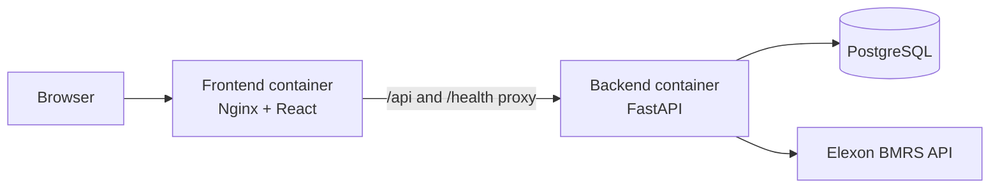

# AeroGrid

AeroGrid is a full-stack wind generation forecast evaluation dashboard for the
UK electricity market. It compares day-ahead wind generation forecasts with
actual generation to help assess forecast accuracy and identify periods of
potential wind generation shortfall.

## Demo and repository

- **Live application:** `https://<live-application-url>` *(placeholder)*
- **Public GitHub repository:** `https://github.com/vishwa073/Aerogrid`
- **Local API documentation:** [http://localhost:8000/api/v1/docs](http://localhost:8000/api/v1/docs)

The live application URL has not been specified in this repository and must be
filled in before submission.

## Features

The current implementation provides:

- Forecast accuracy metrics: mean absolute error (MAE), root mean square error
  (RMSE), and signed bias
- Actual-versus-forecast wind generation comparison
- Wind shortfall analysis for matched hourly intervals
- Hourly interval data with delivery-time search and shortfall/surplus filters
- CSV export of the currently filtered interval table
- Configurable day-ahead publication cutoff evaluation through the
  `cutoff_hour_utc` query parameter
- Docker Compose-based local execution for the frontend and backend services

## Technology stack

| Area | Technologies |
| --- | --- |
| Frontend | React 18, TypeScript, Vite, Tailwind CSS, Recharts |
| Backend | Python 3.12, FastAPI, Pydantic, HTTPX |
| Data access | SQLAlchemy asyncio, asyncpg, Alembic |
| Database | PostgreSQL |
| External data source | Elexon BMRS Insights Solution REST API |
| Containerization | Docker, Docker Compose, Nginx |

## Architecture

- **Frontend:** The React application requests evaluation and health data,
  renders KPI cards, charts, the interval table, cutoff information, and
  shortfall analysis. In the production-style container it is served by
  Nginx.
- **Backend API:** The FastAPI application retrieves Elexon actual-generation
  and wind-forecast data, applies the day-ahead forecast-selection rule,
  aggregates actuals to hourly resolution, matches intervals, and calculates
  evaluation metrics.
- **PostgreSQL:** The backend is configured for PostgreSQL and includes
  SQLAlchemy models and an Alembic initial schema for actual-generation and
  wind-forecast records. PostgreSQL is not defined as a service in the current
  `docker-compose.yml`; a reachable database must therefore be supplied
  separately.
- **Elexon API:** The backend uses the configured Elexon BMRS API base URL as
  its upstream data source.
- **Docker Compose:** `docker-compose.yml` builds the backend and frontend,
  exposes their local ports, connects them on the `aerogrid-network`, and
  waits for the backend health check before starting the frontend dependency.



## Evaluation methodology

### January 2026 evaluation

The evaluation covers 1 January through 31 January 2026 UTC. The endpoint
retrieves Elexon wind actuals and forecasts, converts complete pairs of
half-hourly actual readings into hourly averages, selects eligible forecasts,
and matches forecast and actual values by exact UTC delivery timestamp.

Previously validated January 2026 results are:

| Measure | Result |
| --- | ---: |
| Matched hourly intervals | 744 |
| MAE | Approximately 2,122.8 MW |
| RMSE | Approximately 2,616.7 MW |
| Bias | Approximately -1,840.3 MW |
| Shortfall energy | 1,474,276 MWh |

The endpoint returns these values under the `metrics` object and reports the
matched interval count as `matched_interval_count`.

### Metric definitions

- **MAE:** The mean absolute error over matched hourly intervals.
- **RMSE:** The square root of the mean squared error. Squaring the errors
  gives larger errors more influence than MAE.
- **Bias:** The signed mean error over matched intervals.
- **Shortfall energy:** A separate accumulated energy measure in MWh. It is
  not an accuracy score and sums positive forecast-minus-actual gaps over the
  hourly intervals.

The current backend implementation calculates its signed error as
`actual_mw - forecast_mw`. Under that implementation, a negative bias means
actual generation was below forecast generation on average. This is the
convention represented by the current `metrics.bias_mw` response field. If
the assignment requires the opposite presentation convention
(`forecast - actual`), the sign convention should be reconciled in the
implementation and reported results before submission.

### Day-ahead publication cutoff

The evaluation accepts `cutoff_hour_utc`, which defaults to `11`. For each
delivery date, the backend creates a cutoff at that hour on the previous UTC
day, excludes forecast snapshots published after the cutoff, and selects the
latest eligible snapshot for each delivery interval. Forecasts without an
eligible snapshot are omitted rather than filled with zero.

The API response exposes the selected cutoff hour and the resulting matched
intervals, but it does not expose each selected forecast's publication
timestamp. Therefore, the response alone does not independently prove the
publication timestamp of every selected forecast.

## Prerequisites and installation

### Prerequisites

- Docker Desktop with Docker Compose support
- Access to a reachable PostgreSQL database
- Network access to the Elexon BMRS API

The Compose file does not create a PostgreSQL container. Set `DATABASE_URL`
to use an external PostgreSQL database and to obtain a successful database
readiness response. The Compose container health check uses the liveness
endpoint, so the backend process can be reachable even while the database is
unavailable.

### Clone the repository

```powershell
git clone https://github.com/vishwa073/Aerogrid.git
cd Aerogrid
```

For the checked-out project, the directory containing `docker-compose.yml` is
the project root.

### Configure environment variables

Create a root `.env` file from the supplied template:

```powershell
Copy-Item .env.example .env
```

For Docker Compose, set `DATABASE_URL` in `.env` to a reachable PostgreSQL
connection URL using your own values. Do not commit credentials or the `.env`
file. A placeholder format is:

```dotenv
DATABASE_URL=postgresql+asyncpg://<user>:<password>@<host>:<port>/<database>
```

The Compose configuration supplies the application name, API prefix, Elexon
API base URL, development settings, CORS origins, and the default
`11:00` cutoff. The `.env.example` file also documents settings used for
direct backend or frontend development, including `VITE_API_BASE_URL`.

### Start the services

From the project root:

```powershell
docker compose -f docker-compose.yml up --build -d
```

Check container status and health:

```powershell
docker compose -f docker-compose.yml ps
```

Stop and remove the Compose containers and network:

```powershell
docker compose -f docker-compose.yml down
```

## Local URLs and API endpoints

When the Compose services are running:

| Purpose | URL |
| --- | --- |
| Frontend dashboard | [http://localhost:3000](http://localhost:3000) |
| Backend API base | [http://localhost:8000](http://localhost:8000) |
| FastAPI Swagger documentation | [http://localhost:8000/api/v1/docs](http://localhost:8000/api/v1/docs) |

Available routes verified in the backend:

| Method | Route | Purpose |
| --- | --- | --- |
| `GET` | `/health` | Liveness response used by the container health check |
| `GET` | `/health/ready` | Readiness response; returns `503` when the database is unavailable |
| `GET` | `/api/v1/health` | Versioned liveness route |
| `GET` | `/api/v1/evaluation/january-2026?cutoff_hour_utc=11` | January 2026 hourly forecast evaluation |

The frontend container proxies `/api/` and `/health` to the backend container
through the Docker network. The evaluation route accepts a cutoff hour from
`0` through `23`.

## Project structure

```text
AeroGrid/
├── backend/
│   ├── alembic/
│   ├── app/
│   │   ├── api/routes/
│   │   ├── core/
│   │   ├── db/
│   │   ├── models/
│   │   ├── schemas/
│   │   └── services/
│   ├── tests/
│   ├── Dockerfile
│   ├── requirements.txt
│   └── requirements-dev.txt
├── frontend/
│   ├── src/
│   │   ├── components/
│   │   ├── hooks/
│   │   ├── services/
│   │   ├── styles/
│   │   └── types/
│   ├── Dockerfile
│   ├── nginx.conf
│   ├── package.json
│   ├── package-lock.json
│   └── vite.config.ts
├── .env.example
├── docker-compose.yml
├── frontend-structure-and-code.txt
└── README.md
```

## Testing and validation

### Backend tests

The backend test suite uses `pytest`, `pytest-asyncio`, and HTTPX test
clients. Run it from the backend directory:

```powershell
Set-Location .\backend
python -m pytest tests -v
Set-Location ..
```

The tests cover health routes, evaluation behavior, forecast selection,
hourly aggregation, metrics, Elexon client behavior, and database models.
Tests use mocked upstream responses and isolated test database fixtures where
appropriate; running them does not establish that the live Elexon API or an
external PostgreSQL instance is available.

### Frontend validation

Run the frontend TypeScript check and production build from the frontend
directory:

```powershell
Set-Location .\frontend
npm install
npm run lint
npm run build
Set-Location ..
```

For a service-level check after starting Compose, inspect
`docker compose -f docker-compose.yml ps` and request
[http://localhost:8000/health/ready](http://localhost:8000/health/ready).

## AI Tools and Development Assistance

ChatGPT was used for documentation improvement during this project. Its role
was to help organize the assignment README, explain implementation details
clearly, and identify documentation gaps while reviewing the repository.

AI suggestions were reviewed against the implementation. The API routes,
evaluation logic, cutoff behavior, and reported metrics were checked against
the available source code and project evidence. AI output was not assumed to
be automatically correct.

## Limitations and future improvements

The following are future improvements, not current features:

- Evaluate additional months or rolling periods beyond January 2026.
- Expand automated coverage for live-data integration and end-to-end
  frontend behavior.
- Add production-focused authentication, authorization, secret management,
  and stricter deployment security settings.
- Add operational monitoring, structured metrics, and alerting for upstream
  Elexon or database failures.
- Continue refining dashboard accessibility, responsive behavior, and
  interaction details.

## License

No license has been specified in this repository yet.
